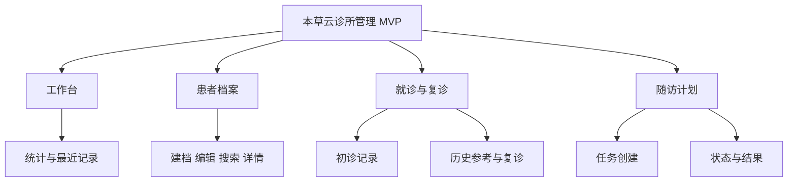
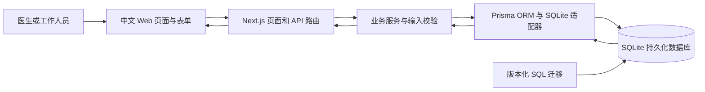
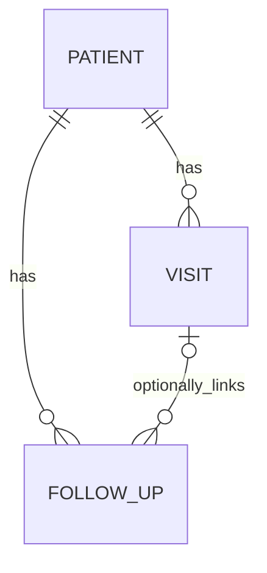

# 产品功能与技术架构

以下描述现有实现的高层关系，不包含私有源码、数据库迁移内容、环境文件或部署凭据。AI 在本文中只作为未来边界说明。

## 产品功能架构

这些模块围绕同一患者关联，当前是单诊所演示空间。登录、角色、多租户、处方、收费和药房不在已交付功能中。

## Web 应用、业务服务与数据库

表单通过 API 写入；服务端负责输入、关联、日期和顺序校验；数据库约束保护并发写入。页面读取同一持久化数据源，避免只在浏览器内保存展示数据。

## 实际技术选择

| 层次 | 使用技术 | 选择与边界 |
| --- | --- | --- |
| Web 框架 | Next.js 16.4.0 | 页面与 API 同一应用，需 Node.js 服务 |
| 交互与类型 | React 19.3.0、TypeScript 5.9 | 中文表单与类型约束 |
| 样式 | Tailwind CSS 4 | 管理后台与响应式布局 |
| 输入校验 | Zod | 必填、格式、日期等输入约束 |
| 数据访问 | Prisma 7.10.0、SQLite 适配器 | 实际读写与事务 |
| 持久化 | SQLite | 适合个人 MVP 的本地文件持久化；不能直接假定支持多实例生产部署 |
| 数据库升级 | 版本化 SQL 迁移 | 原子应用、校验和及数据库写入约束 |
| 验证 | Node 测试、DOM 测试、HTTP 测试、GitHub Actions | 11 项回归与构建检查，不等同于真实临床验证 |

版本为本次作品集核对快照。没有使用向量数据库、模型服务、云消息队列或指定云托管产品，不绘制不存在的云组件。

## 高层数据关系

- 每次就诊属于一个患者，初诊和复诊是同一就诊记录类型体系中的不同类型。
- 每项随访属于一个患者，可以关联某次就诊；关联时必须是同一患者。
- 此图是关系说明，没有导出数据表、字段定义或数据库文件。

## 一致性与边界

患者编号重复由服务端提示和数据库写入保护共同处理，保留旧重复档案。复诊须有前序就诊，日期不得早于最近记录；随访日期使用统一诊所时区。具体决策见 [产品决策](product-decisions.md)。

当前没有登录鉴权、多租户隔离、审计系统、备份自动化或高可用设计，不能将这一架构描述成生产医疗基础设施。

## 展示网站与业务系统的区别

本公开仓库的展示网站是静态 HTML/CSS 与 Markdown 文档阅读页，适合 GitHub Pages。它不启动 Next.js 业务服务，不连接患者数据库，不接收病历输入，也不提供诊疗操作。

文档中的 AI 模块尚未实现，不属于上图实际运行链路。
