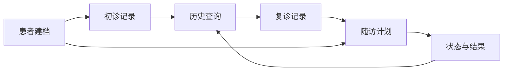
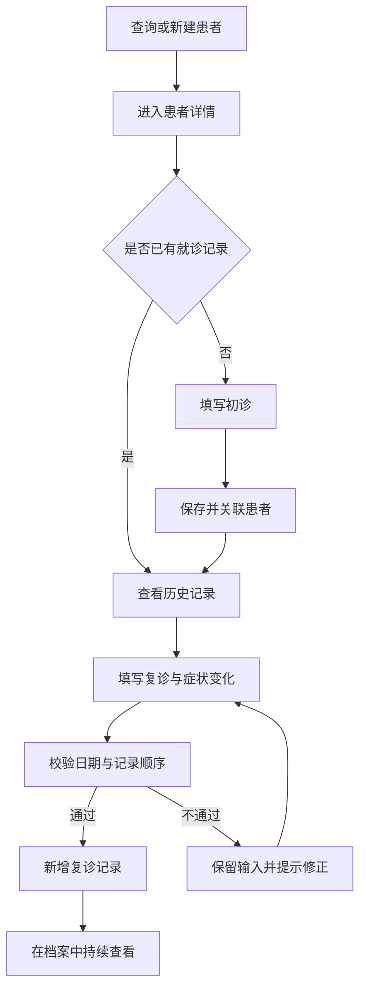
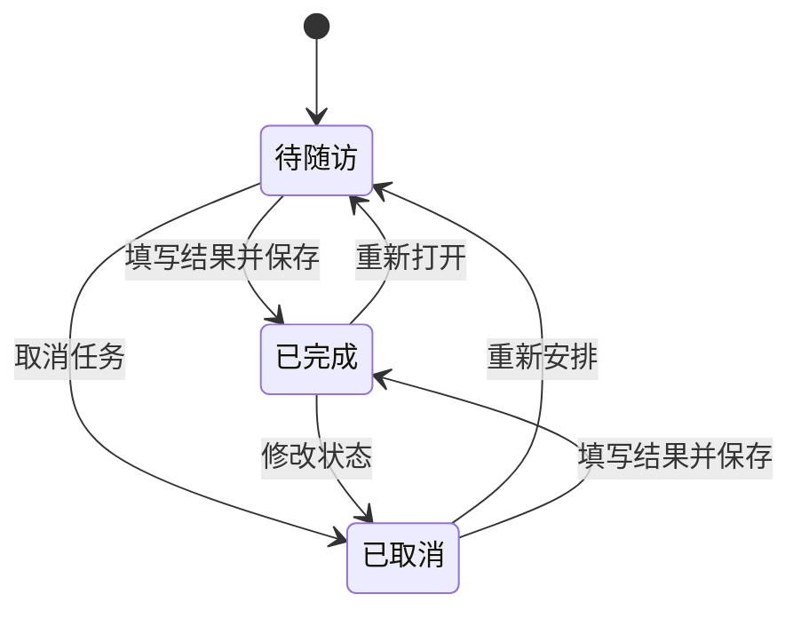

# 业务流程与随访生命周期

这些流程描述当前 MVP。所有业务示例仅用于虚构演示，不代表真实患者或临床结果。

## 整体业务主线

建档后可以独立安排随访，不要求每位患者都执行完整主线。系统没有自动预约、发消息或自动关闭任务功能。

## 初诊到复诊

**输入与输出**：患者档案是入口；初诊形成基线，复诊保留为新记录。医生填写主诉、评估和方案，不由 AI 生成。历史参考帮助组织信息，不证明已实现自动比较。

**约束**：未有初诊不能创建复诊，已有记录不重复创建初诊；就诊日期不能晚于当前诊所日期，复诊不能早于最近一次就诊。当前没有复杂的挂号、排队或审批流。

## 随访任务生命周期

三个状态都可在当前界面中修改，并非终止后不可编辑的工单系统。完成时要求结果；重新变为未完成状态时清除完成时间，任务和历史关联本身不删除。逾期是基于日期的展示提示，不会触发自动联系。

## 一个虚构演示路径

“演示患者 A”完成建档，医生填写一条虚构初诊记录。再次进入档案，医生对照历史补充复诊变化，并安排一项线上随访。后续将任务标记为已完成并填写虚构结果，刷新后仍可读取。

这个示例只说明产品操作顺序，不提供医疗判断、用药或真实随访效果。真实界面截图尚待作者提供和逐张脱敏。
